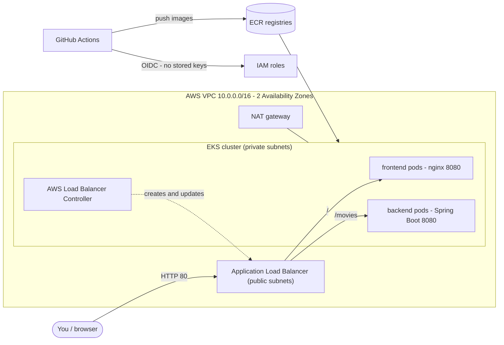

# Netflix Service on AWS EKS

A small Netflix-style movie catalogue (Spring Boot API + nginx web page) that you can **deploy to your own AWS
account with a few clicks in GitHub Actions** – network, Kubernetes cluster, container registry, load balancer and
the app itself are all created automatically from code, with security guardrails built in.

> New to this? Read this file top to bottom and follow the numbered steps. Nothing here needs prior Kubernetes or
> Terraform knowledge. For the "why" behind every decision (great for interview prep) see
> [docs/BUILD-LOG.md](docs/BUILD-LOG.md) and [docs/INTERVIEW-GUIDE.md](docs/INTERVIEW-GUIDE.md).

---

## What you get



| Piece | Tool | Where |
|---|---|---|
| One-time setup (state bucket, GitHub→AWS trust, budget alert) | Terraform | [bootstrap/](bootstrap) |
| Network, EKS cluster, registries, IAM | Terraform | [infra/](infra) |
| App deployment (pods, services, ingress, policies) | Kubernetes YAML + Kustomize | [k8s/](k8s) |
| CI/CD | GitHub Actions | [.github/workflows/](.github/workflows) |
| Old CI | Jenkins (kept as-is) | [Jenkinsfile](Jenkinsfile) |

---

## Before you start

You need:

1. An **AWS account** you own (a personal one is fine) and permission to create resources in it (admin is easiest).
2. A **GitHub account** and this repository pushed to it.
3. On your computer: [Git](https://git-scm.com), the [AWS CLI v2](https://docs.aws.amazon.com/cli/latest/userguide/getting-started-install.html),
   [Terraform 1.10 or newer](https://developer.hashicorp.com/terraform/install) (tested with 1.17.1) and, optionally,
   the [GitHub CLI](https://cli.github.com) (`gh`) – the UI works too.

> **Cost warning.** While running, this stack costs roughly **USD 0.25–0.30 per hour (~USD 200/month)**:
> EKS control plane, 2 small servers, a NAT gateway and a load balancer. A 2-hour demo is under USD 1.
> **Always run the Destroy workflow (step 7) when you are done.** Step 2 also creates a budget alarm for you.

---

## Step-by-step

### 1. Push the code to GitHub

```bash
git add -A
git commit -m "Add EKS infrastructure, Kubernetes manifests and pipelines"
git push origin main
```

### 2. Prepare your AWS account (one time, about 10 minutes)

1. **Protect the root user**: sign in to AWS, turn on MFA for the root user, and do not use root for daily work.
2. **Create a day-to-day admin identity** (IAM Identity Center user is best; an IAM user with admin permissions
   also works) and log in from your terminal:

   ```bash
   aws configure sso          # or: aws configure
   aws sts get-caller-identity   # must print your account id – this proves the CLI works
   ```

3. **Run the bootstrap Terraform** – it creates the things GitHub Actions needs *before* it can run:
   an encrypted S3 bucket for Terraform state, a trust between GitHub and AWS (OIDC, so **no passwords or
   access keys are ever stored in GitHub**), two IAM roles (read-only "plan" and scoped "deploy") and a
   monthly budget email alert.

   ```bash
   cd bootstrap
   cp terraform.tfvars.example terraform.tfvars     # then edit: set budget_email to your email
   terraform init
   terraform apply                                  # review the list, type: yes
   ```

   - If AWS says a GitHub OIDC provider already exists, set `create_github_oidc_provider = false` in
     `terraform.tfvars` and apply again.
   - Keep the `bootstrap/terraform.tfstate` file safe (it is git-ignored on purpose).
   - Confirm the budget subscription email that AWS sends you.

### 3. Tell GitHub about your AWS account

`terraform apply` printed ready-made commands. Show them again and run them (they set **repository variables**;
no secrets are needed):

```bash
terraform output -raw github_variables_cli        # prints 5 'gh variable set ...' lines – copy/paste and run them
cd ..
```

No `gh` CLI? In GitHub go to **Settings → Secrets and variables → Actions → Variables** and add these 5 variables
by hand, using the values from `terraform output`:

| Variable | Meaning |
|---|---|
| `AWS_REGION` | e.g. `ap-south-1` |
| `TF_STATE_BUCKET` | state bucket name |
| `TF_STATE_KMS_KEY_ARN` | KMS key that encrypts the state |
| `AWS_PLAN_ROLE_ARN` | read-only role used for plans |
| `AWS_DEPLOY_ROLE_ARN` | role used for apply / deploy / destroy |

Optional: `EXTRA_ADMIN_ARNS` = a JSON list of IAM role (or user) ARNs that should also get `kubectl` admin access to the
cluster from your laptop, e.g. `["arn:aws:iam::123456789012:role/MyAdminRole"]`
(for IAM Identity Center roles remove the `/aws-reserved/sso.amazonaws.com/<region>/` part from the ARN).

### 4. Create the protected "production" environment (the approval gate)

GitHub → **Settings → Environments → New environment → `production`**, then:

- **Required reviewers**: add yourself. Every deploy/destroy then pauses until you click *Approve*.
- **Deployment branches and tags**: *Selected branches* → `main`.

> Private repo on the GitHub Free plan? Environment protection rules are only available on public repos or paid
> plans. The pipeline still works without the approval click, and the AWS side still only trusts this environment.

### 5. Deploy

GitHub → **Actions → "Deploy (provision AWS + run the app on EKS)" → Run workflow** (branch `main`).

1. **First time, tick `plan_only`.** It shows exactly what would be created (open the run → *Summary*). Nothing is changed.
2. Run it again **without** `plan_only`. When the `Apply + deploy to EKS` job says *Waiting*, click
   **Review deployments → production → Approve**.
3. Wait about **25–35 minutes** (the EKS cluster alone takes ~12). The pipeline then:
   creates AWS resources → builds & pushes the two images → installs the load balancer controller →
   deploys the app → waits for the load balancer → tests it.
4. Open the run **Summary**: it contains the URL, e.g. `http://k8s-netflix-xxxx.ap-south-1.elb.amazonaws.com`.
   Open it – you should see the "Trending Now" movie cards. The API is at `/movies`.

### 6. (Optional) Look inside the cluster

Only works if you set `EXTRA_ADMIN_ARNS` (step 3) and re-ran the Deploy workflow once.

```bash
aws eks update-kubeconfig --region ap-south-1 --name netflix-eks
kubectl get nodes
kubectl -n netflix get pods,svc,ingress
kubectl -n netflix logs deploy/backend
kubectl -n netflix top pods
```

To open a shell on a worker node without SSH: `aws ssm start-session --target <instance-id>`.

### 7. Tear everything down (stop the bill)

GitHub → **Actions → "Destroy (tear everything down)" → Run workflow**, type `destroy`, approve. It removes the app, the
load balancer, the cluster, the network and the registries (~15–20 minutes).

What stays (tiny cost, about USD 1/month for the KMS key): the state bucket, IAM roles and budget from step 2.
To remove those too (only when you are completely finished):

1. Empty the S3 state bucket in the console (*Empty*, including all versions).
2. `cd bootstrap && terraform destroy`

---

## How the pipelines work

| Workflow | Runs when | What it does |
|---|---|---|
| [ci.yml](.github/workflows/ci.yml) | every PR and push to `main` | Terraform fmt/validate/lint/unit-tests, IaC + secret scans, manifest validation, builds both images (backend tests run inside the build) and scans them |
| [plan.yml](.github/workflows/plan.yml) | PRs touching `infra/` | Posts the Terraform plan on the PR using the **read-only** role |
| [deploy.yml](.github/workflows/deploy.yml) | manual | preflight → CI → plan → **approval** → apply the *exact reviewed plan* → build/push → deploy → smoke test |
| [destroy.yml](.github/workflows/destroy.yml) | manual, must type `destroy` | removes ALB/app first, then `terraform destroy` |

### Guardrails at a glance

- **No stored AWS keys** – GitHub proves its identity to AWS with short-lived OIDC tokens.
- **Two roles**: plan = read-only; deploy = scoped permissions that only the `production` environment (on `main`) can use. The deploy role cannot edit its own roles.
- **Manual approval + typed confirmation** for anything that changes or deletes infrastructure; one operation at a time (concurrency lock).
- **State**: encrypted with a KMS key, versioned, private, TLS-only, locked during runs.
- **Network**: nodes in private subnets, no SSH, IMDSv2, VPC flow logs, locked-down default security group.
- **Cluster**: IAM-only access (access entries), secrets encrypted with KMS, all control-plane logs, network policies enforced, Pod Security "restricted".
- **Containers**: non-root, read-only filesystem, no capabilities, resource limits, health probes, autoscaling, disruption budgets.
- **Supply chain**: actions pinned to commit SHAs, Dependabot, immutable ECR tags + scan on push, Trivy IaC/secret/image scans failing on HIGH/CRITICAL.
- **Cost**: budget alerts, node cap (max 6), image retention policy, one-click destroy.

---

## Customising

| I want to… | Change |
|---|---|
| Use another region | `AWS_REGION` variable and `region` in `bootstrap/terraform.tfvars` (rerun bootstrap) |
| Cheaper nodes | in [infra/variables.tf](infra/variables.tf) set `node_capacity_type = "SPOT"` |
| Bigger/smaller cluster | `node_instance_types`, `node_desired_size`, `node_max_size` |
| Different VPC range | `vpc_cidr` **and** the CIDR in [k8s/networkpolicy.yaml](k8s/networkpolicy.yaml) |
| Restrict the site to my IP | add `alb.ingress.kubernetes.io/inbound-cidrs: <your-ip>/32` to [k8s/ingress.yaml](k8s/ingress.yaml) |
| Use HTTPS | needs a domain + ACM certificate: add `certificate-arn` and `listen-ports` annotations to the ingress |

Keep `name = "netflix"` unless you change it in **both** `bootstrap/` and `infra/` (IAM permissions and the state path use it).

## Troubleshooting

| Symptom | Likely cause / fix |
|---|---|
| Deploy fails instantly at *Preflight* | a repository variable is missing – redo step 3 |
| `Not authorized to perform sts:AssumeRoleWithWebIdentity` | the `production` environment doesn't exist/was renamed (step 4), or you ran from a branch other than `main` |
| `AccessDenied` during apply | deploy role is missing a permission. Look at the error's action, or temporarily set `deploy_role_admin_access = true` in bootstrap, re-apply, finish, then set it back to `false` |
| Smoke test can't reach the URL | the ALB takes 2–5 min to become active; the step already retries. Check *Cluster diagnostics* output |
| Pods `Pending` | cluster out of capacity – raise `node_desired_size` or check `kubectl describe pod` |
| Destroy fails on VPC/subnet | an ALB/ENI is still being released; the workflow retries 3×. Re-run Destroy |
| Page loads but no movies | open `/movies`; if it errors check `kubectl -n netflix logs deploy/backend` |
| `terraform init` bucket errors locally | pass the same 3 `-backend-config` values the pipeline uses (see [infra/versions.tf](infra/versions.tf)) |

## Run the pieces locally (optional)

```bash
# Backend API only (tests run during the image build)
docker build -t netflix-backend backend
docker run --rm -p 8080:8080 netflix-backend      # then open http://localhost:8080/movies

# Infrastructure checks that need no AWS account
cd infra && terraform init -backend=false && terraform validate && terraform test
```

## Repository layout

```
bootstrap/   one-time Terraform (state bucket, OIDC trust, IAM roles, budget)
infra/       main Terraform (VPC, EKS, ECR, IAM for the load balancer controller) + offline tests
k8s/         Kubernetes manifests (kustomize)
backend/     Spring Boot service + multi-stage Dockerfile
frontend/    static site + nginx (non-root) Dockerfile
.github/     workflows, reusable action, Dependabot, CODEOWNERS
docs/        build log and interview guide
Jenkinsfile  original Jenkins pipeline (unchanged, still works)
```
