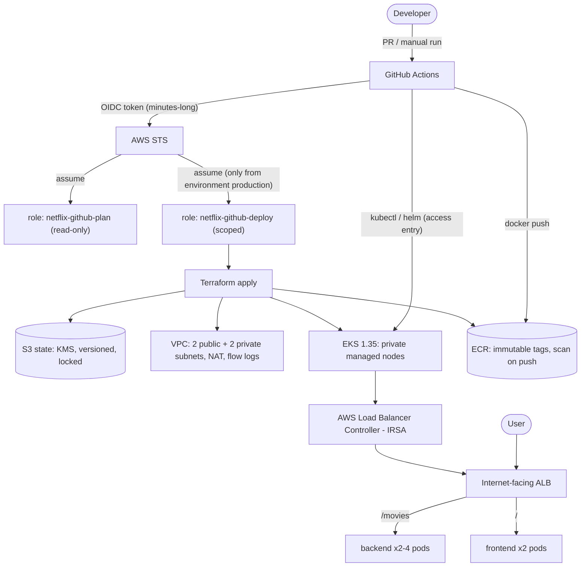

# Interview Guide – talking about this project

Use this to explain the project confidently. Sections: pitch → architecture → request flow → guardrails →
concept Q&A → production next steps → war stories → command cheat-sheet.

---

## 1. The 60-second pitch

> "I took a small Spring Boot + nginx movie app that had no infrastructure and made it deployable to AWS with one
> button. **Terraform** builds a VPC, an **EKS** cluster, ECR registries and the IAM wiring. **GitHub Actions** authenticates to AWS
> with **OIDC – no stored keys** – plans with a read-only role, waits for a human approval, applies the exact reviewed
> plan, builds and scans the images, installs the **AWS Load Balancer Controller**, and deploys the app with
> **Kustomize**. An **ALB** routes `/movies` to the API and `/` to the web page. Security is layered:
> least-privilege roles, encrypted state and secrets, private nodes, non-root read-only containers, network policies,
> pinned actions and Trivy gates. There's a one-click, order-aware **destroy** and a **budget alarm** so it can't
> surprise me on the bill."

---

## 2. Architecture



**Layers:** (1) identity/permissions, (2) network, (3) compute/cluster, (4) workload, (5) delivery pipeline.
Being able to name these layers and talk through each is the core of the interview.

## 3. Request flow (follow a packet)

1. Browser → DNS name of the **ALB** (in the public subnets) on port 80.
2. ALB listener rules (created by the controller from the `Ingress` objects): `/movies*` → backend target group, everything else → frontend.
3. `target-type: ip`: the ALB sends traffic **directly to pod IPs** in the private subnets (no extra NodePort hop).
4. The **NetworkPolicy** only allows ingress from the ALB subnets on 8080.
5. Pod answers; the page's JS calls `/movies` on the **same origin** (so no CORS needed), and `/images/*` is served by nginx.

---

## 4. Guardrails – what, why, where

| Layer | Guardrail | Why it matters | Where |
|---|---|---|---|
| Identity | GitHub **OIDC**, no AWS keys in GitHub | nothing long-lived to steal | `bootstrap/iam.tf` |
| Identity | Separate **plan (read-only)** and **deploy** roles | a PR can't change infrastructure | `bootstrap/iam.tf` |
| Identity | Deploy role trusts only `environment:production` | needs the approval gate to be used | trust policy |
| Identity | **Explicit deny** on editing `netflix-github-*`, and on other regions | blocks self-escalation / region sprawl | `bootstrap/iam.tf` |
| Process | Manual trigger, approval, typed `destroy`, `main` only, concurrency lock | no accidental or parallel changes | `deploy.yml`, `destroy.yml` |
| Process | **Saved plan** applied exactly | what was reviewed is what runs | `deploy.yml` |
| State | KMS-encrypted, versioned, private, TLS-only, locked | state contains sensitive data; must be recoverable | `bootstrap/main.tf` |
| Supply chain | Actions pinned to **commit SHA**; Dependabot | tags can be moved by attackers | workflows |
| Supply chain | Trivy IaC + secret + image scans fail on HIGH/CRITICAL | shift security left | `ci.yml` |
| Supply chain | ECR **immutable tags** + scan on push + lifecycle | tag can't be silently overwritten | `infra/ecr.tf` |
| Network | Private nodes, no SSH, IMDSv2 (hop limit 1), default SG empty, flow logs | small attack surface, audit trail | `infra/network.tf`, `eks.tf` |
| Cluster | IAM-only access entries; **KMS secrets encryption**; all control-plane logs | strong authN, defence in depth, audit | `infra/eks.tf` |
| Workload | Pod Security **restricted**, non-root, read-only FS, drop ALL caps, limits, probes | limits blast radius of a compromised pod | `k8s/` |
| Workload | **NetworkPolicy** default-deny | zero-trust between pods | `k8s/networkpolicy.yaml` |
| Reliability | HPA, PDB, 2 replicas, topology spread, rolling update `maxUnavailable: 0` | survives node drains and zone issues | `k8s/` |
| Cost | Budget alarm, node cap ≤ 6, destroy workflow, image retention | no surprise bill | bootstrap, variables |
| Quality | `terraform test` with mocked provider, tflint, actionlint, kubeconform | catches errors before AWS does | `ci.yml`, `infra/tests` |

---

## 5. Concept Q&A (likely interview questions)

**Why OIDC instead of access keys?**
GitHub issues a signed JWT per job. AWS verifies it against the OIDC provider and checks the `sub` claim
(`repo:owner/repo:environment:production`) in the role's trust policy, then hands out credentials valid for ≤ 2 h. No secret
to rotate or leak, and the trust is scoped to repo + environment.

**How does the `sub` claim change between jobs?**
Job with `environment:` → `repo:o/r:environment:<name>`; PR job → `repo:o/r:pull_request`; plain branch job → `repo:o/r:ref:refs/heads/<branch>`.
That's why plan role trusts the latter two and deploy role trusts only the environment form.

**What is the bootstrap problem?**
Terraform needs a state bucket and the pipeline needs a role *before* either can be created by the pipeline itself.
Solve it with a tiny separately-applied stack with local state.

**How does Terraform state locking work here?**
`use_lockfile = true` makes the S3 backend create a `.tflock` object using S3 conditional writes (Terraform ≥ 1.10).
It replaces the old DynamoDB lock table.

**Why a saved plan?**
Plan → approve → apply the *same* artifact. Prevents "plan looked fine, apply did something else" and detects state drift between the two.

**Explain IRSA.**
The cluster has an OIDC issuer. An IAM role trusts that issuer with a condition on the service account
(`system:serviceaccount:kube-system:aws-load-balancer-controller`). The pod gets a projected token; AWS SDKs exchange it for role credentials.
Result: pod-level IAM, not node-level. (Newer alternative: **EKS Pod Identity** – simpler trust, needs an agent add-on.)

**Access entries vs `aws-auth` ConfigMap?**
Access entries are managed through the EKS API (IAM-native, auditable, can't be broken by a YAML typo). The ConfigMap was a single point of failure – one bad edit could lock everyone out.

**Why did you disable "cluster creator admin"?**
Because plan and apply run as different identities; the module would have granted admin to the *plan* role. I grant the deploy role explicitly.
(Great "real problem I anticipated" story.)

**ALB `ip` vs `instance` target type?**
`ip`: ALB targets pod IPs directly through the VPC CNI – fewer hops, better health-check accuracy, works with Fargate. `instance`: goes via NodePort/kube-proxy.

**Why a NAT gateway, and what are the alternatives?**
Private nodes need outbound access (ECR, STS, EKS API). One NAT is cheap but a single-AZ point of failure and costs ~USD 32+/month plus data.
Alternatives: NAT per AZ (HA), or VPC endpoints for ECR/S3/STS/logs (more private, more setup).

**Why is the EKS API endpoint public?**
GitHub-hosted runners have no VPC access. Mitigations: IAM authentication is mandatory, access is least-privilege via access entries, optional CIDR allow-list
variable. Production answer: private endpoint + self-hosted runners in the VPC.

**What does Pod Security "restricted" enforce?**
Non-root, no privilege escalation, `drop ALL` capabilities, seccomp RuntimeDefault, no host namespaces/paths. Non-compliant pods are **rejected at admission**.

**Why is `readOnlyRootFilesystem` possible with Spring/nginx?**
Mount an `emptyDir` at `/tmp` (Tomcat work dir, nginx pid/temp files). Everything else is read-only, so an attacker can't drop binaries.

**HPA vs PDB?**
HPA changes replica count based on load (needs metrics-server – installed as an EKS add-on). PDB limits voluntary disruption (drains/upgrades) so at least 1 pod stays up.

**How do rolling updates stay zero-downtime?**
`maxUnavailable: 0, maxSurge: 1` + readiness probes (the new pod must pass `/movies` before an old one is removed) + ALB health checks + PDB.

**Why Kustomize and not Helm for the app?**
App is simple and the only dynamic bit is the image tag. Kustomize ships in `kubectl`, no templating language. (I did use Helm for the third-party controller – that's the normal packaging for it.)

**How do you roll back?**
App: `kubectl rollout undo deployment/backend` or re-run Deploy on an older commit (images are immutable and kept). Infra: revert the commit and run Deploy (reviewed plan); state is versioned in S3 if it must be restored.

**Why immutable ECR tags with the git SHA?**
Traceability (running image ⇒ exact commit) and tamper-resistance. Side effect: the pipeline must skip pushes for existing tags – handled.

**What stops someone abusing the deploy role?**
Trust only from `environment:production` on `main` (approval needed), session ≤ 2 h, scoped permissions limited to `netflix-*` IAM resources and one region, explicit deny on editing the pipeline's own roles, CloudTrail records everything.
Honest limitation: it can still create roles named `netflix-*`, so a **permissions boundary** would be the next hardening step.

**What would make `terraform destroy` fail and how did you prevent it?**
The ALB/security groups made by the controller are outside Terraform. The destroy workflow deletes the Ingress (controller removes ALB), uninstalls the controller, waits, then destroys with retries.

**How do you control cost?**
Budget alerts, node max cap validation, one NAT, ECR lifecycle policy, short log retention, manual trigger, and the destroy workflow. Know the numbers: EKS control plane ≈ USD 73/mo, NAT ≈ 32–41, ALB ≈ 17+, 2×t3.medium ≈ 60–70 (rough, region dependent).

---

## 6. What I'd do next in production

1. **HTTPS**: Route 53 + ACM certificate, redirect 80→443, `ssl-policy`.
2. **WAF** on the ALB, access logs to S3.
3. **Private API endpoint** + self-hosted/ephemeral VPC runners; VPC endpoints instead of (or with) NAT.
4. **Permissions boundary** for the deploy role; split the role into infra vs app-deploy.
5. **Multiple environments** (dev/stage/prod) via separate state keys / workspaces, promotion pipeline.
6. **GitOps** (Argo CD/Flux) – cluster pulls desired state instead of the pipeline pushing.
7. **Observability**: Container Insights or Prometheus + Grafana, alerts, SLOs; structured logging.
8. **Secrets**: External Secrets Operator + Secrets Manager (this app has none yet).
9. **Image signing & SBOM** (cosign/Sigstore, Kyverno policy to require signed images).
10. **Autoscaling nodes**: Karpenter or Cluster Autoscaler; Graviton/Spot mix.
11. **Scheduled drift detection** (`terraform plan -detailed-exitcode` nightly).
12. **Backups/DR**: multi-AZ NAT, cross-region ECR replication, state bucket replication.

---

## 7. War stories (the real problems found while building)

| Problem | How it was found | Fix | Lesson |
|---|---|---|---|
| Module v21 renamed inputs | read the module's `variables.tf` after `init` | used new names | pin versions and read the docs *for that version* |
| Plan identity ≠ apply identity → deploy role would get no `kubectl` access | reasoned through how `enable_cluster_creator_admin_permissions` resolves the caller | explicit access entry for deploy role | think about *who* runs each pipeline stage |
| Frontend would lose its images | listed the full tree (earlier listing hid `*.png`) | `COPY images` | never filter your inventory |
| Hard-coded EC2 IP + open CORS | code review | relative URL, remove CORS | environment config does not belong in code |
| Old Spring Boot 3.2.0 → vulnerable libraries would break the Trivy gate | checked versions on Maven Central | bump to 3.5.16 | security gates force dependency hygiene |
| State bucket flagged by Trivy (no CMK) and frontend Dockerfile (no `USER`) | local IaC scan | KMS key + `USER 101` | run the scanners locally before CI |
| ALB would block VPC deletion | knowledge of controller-managed resources | ordered destroy workflow | resources created by controllers aren't in Terraform state |
| Re-running a deploy on the same commit would fail on immutable tags | traced the push step | `describe-images` guard | immutability needs idempotent pipelines |
| Local Trivy/kubeconform blocked by corporate TLS inspection | certificate errors | rely on CI runners for those two | know which checks actually ran where |

---

## 8. Command cheat-sheet

```bash
# AWS identity
aws sts get-caller-identity

# Terraform
terraform init -backend-config="bucket=$B" -backend-config="region=$R" -backend-config="kms_key_id=$K"
terraform plan -out=tfplan && terraform show tfplan
terraform state list
terraform output -json

# EKS / Kubernetes
aws eks update-kubeconfig --region ap-south-1 --name netflix-eks
kubectl get nodes -o wide
kubectl -n netflix get pods,svc,ingress,hpa,pdb,networkpolicy
kubectl -n netflix describe pod <pod>
kubectl -n netflix logs deploy/backend -f
kubectl -n netflix rollout status deploy/backend
kubectl -n netflix rollout undo deploy/backend
kubectl -n netflix top pods
kubectl -n kube-system logs deploy/aws-load-balancer-controller
kubectl auth can-i --list -n netflix

# Debugging the ALB
kubectl -n netflix get ingress -o wide
aws elbv2 describe-load-balancers
aws elbv2 describe-target-health --target-group-arn <arn>

# ECR
aws ecr describe-images --repository-name netflix-backend
aws ecr describe-image-scan-findings --repository-name netflix-backend --image-id imageTag=<sha>
```
